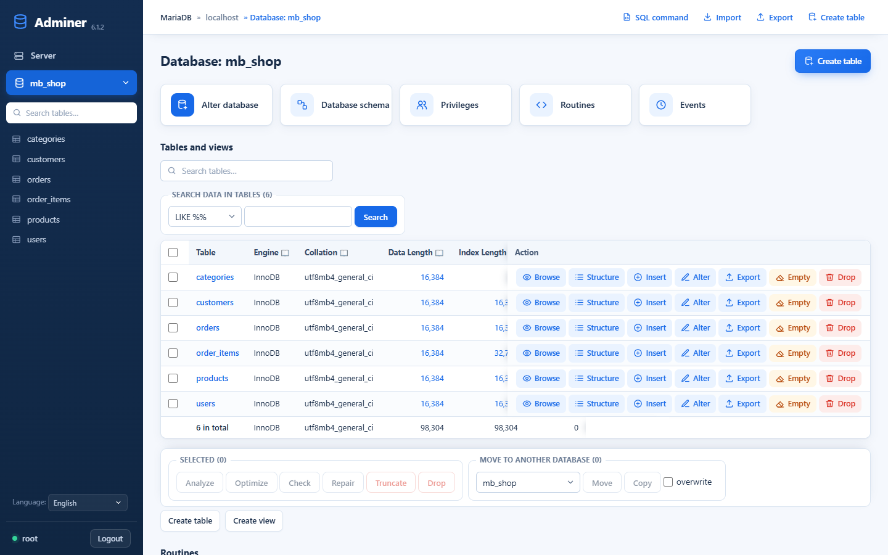
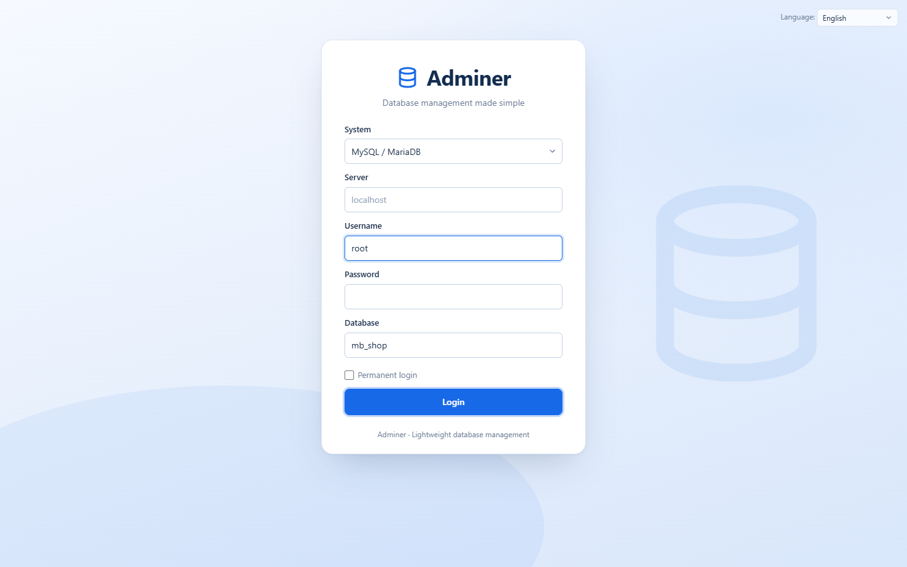
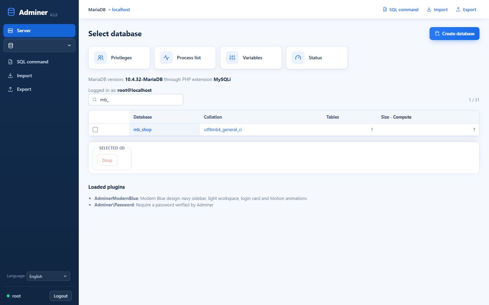
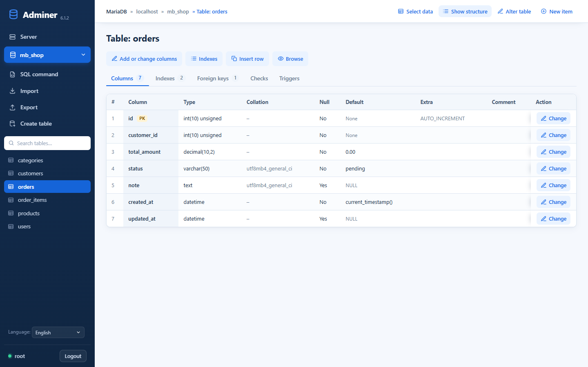
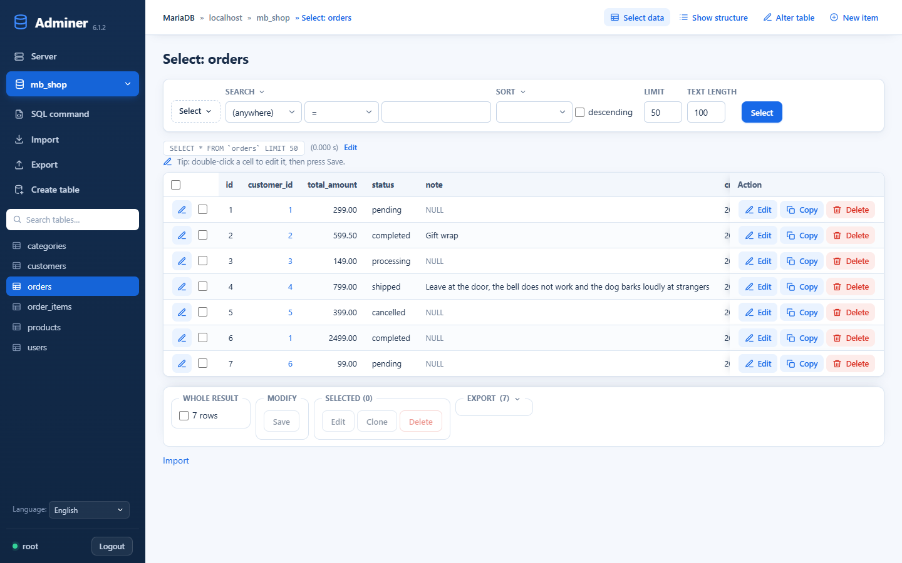
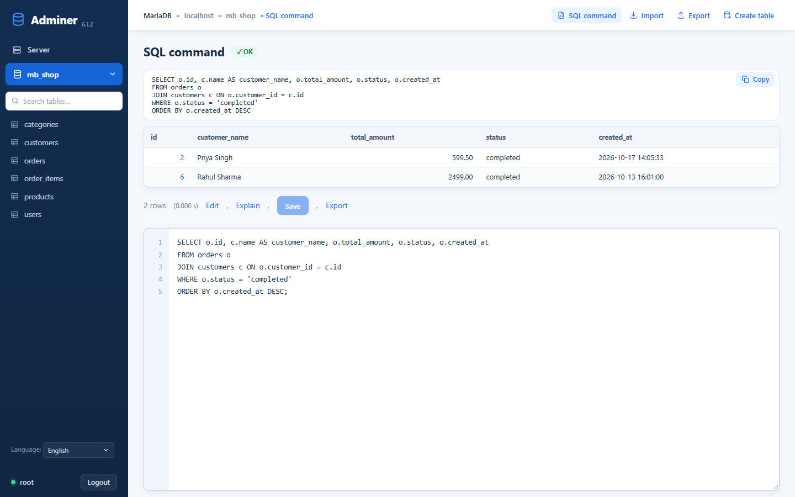
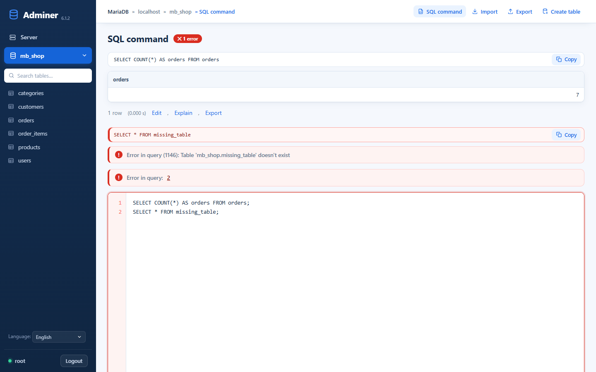
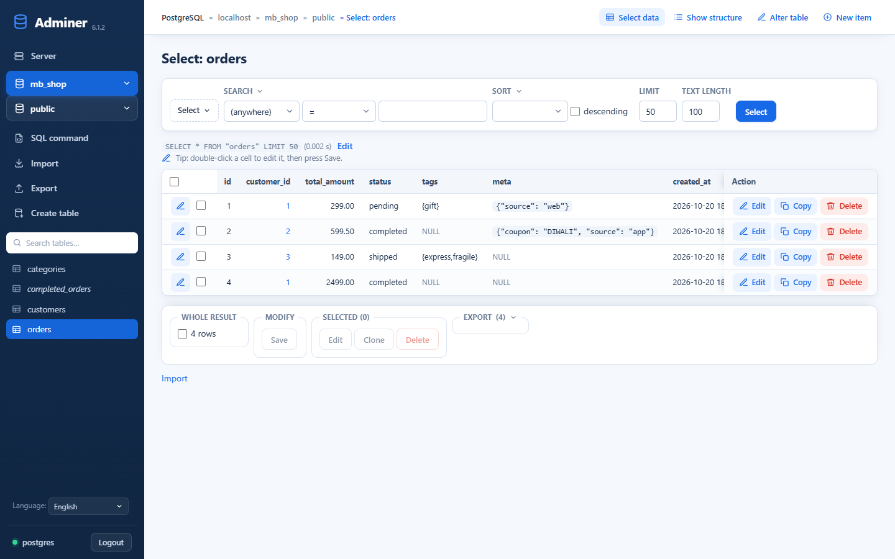
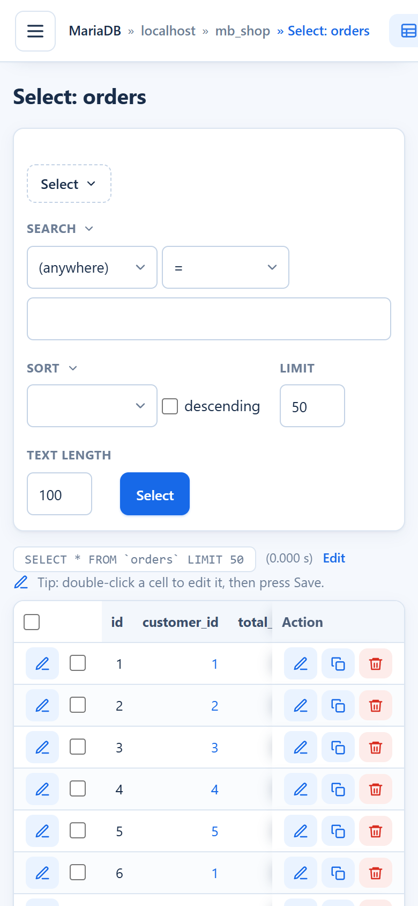
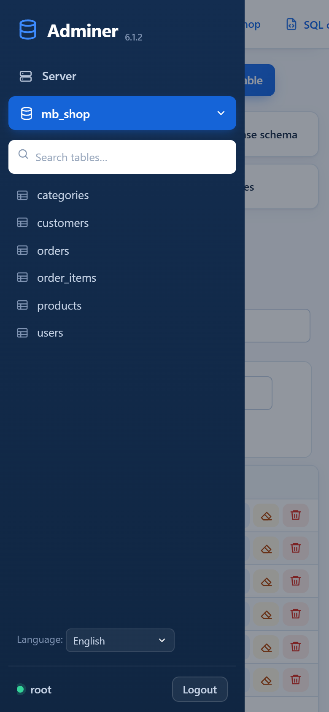

<div align="center">

# Adminer Modern Blue

**A modern, animated dashboard look for [Adminer](https://www.adminer.org/) — navy sidebar, clean blue/white workspace, smooth Motion animations.**
Same Adminer engine underneath: every query, login, export and import still goes through Adminer's own code.




</div>

---

## ✨ Highlights

- **Dashboard layout** – fixed navy sidebar with the server link, database (and schema) switcher, live table search and table list; a top bar with breadcrumb and the main actions.
- **Login card** – centered card on a soft blue backdrop, labels above the fields, clear red error box.
- **Data grids** – rounded cards, sticky headers, zebra rows, hover highlight, inline `edit` chips, page-number chips.
- **Table structure** – tabs for *Columns / Indexes / Foreign keys / Checks / Triggers* with counters, plus a detailed column grid (type, collation, null, default, extra, comment, `PK` badge).
- **Select data** – search and sort right in the toolbar, compact limit fields, readable rows, horizontal scroll for wide tables.
- **SQL editor** – line numbers, focus ring, and **errors in red**: the failed statement, the message, the editor border and a `✕ 1 error` badge next to the heading (a green `✓ OK` badge when all statements pass).
- **phpMyAdmin-style row actions with icons** (shown only when the user has the permission):
  - every data row: ✏️ **Edit**, 📄 **Copy**, 🗑️ **Delete** – the action column stays visible while scrolling wide tables
  - **double-click any cell to edit it in place**, then press *Save*
  - every table in a database: 👁️ **Browse**, ☰ **Structure**, ➕ **Insert**, ✏️ **Alter**, 🧹 **Empty**, 🗑️ **Drop** (with Adminer's confirmation)
  - table structure: **Add or change columns**, **Indexes**, **Add foreign key**, **Insert row**, **Browse**, and **Change** on every column
- **Quick action cards** on the server and database pages – Users & privileges, Process list, Variables, Status, Database schema, Routines, Events.
- **Export any single table** from its row, and a **Copy** button on every executed SQL statement.
- **Search boxes** above the database and table lists.
- **Motion animations** – staggered page entrance, row cascade, spring login card, sliding tab indicator, a hover pill following the sidebar tables, button ripples and press springs, error shake, count-up numbers, scroll reveal, top loading bar, animated mobile drawer.
- **Responsive on every screen** – checked automatically at 1440, 1024, 768, 390 and 320 px on 11 screens with zero horizontal overflow; wide tables scroll inside their own box, action buttons shrink to icons, forms stack on phones, and the sidebar becomes a drawer with backdrop and <kbd>Esc</kbd> to close.
- **Accessible & light** – respects *reduce motion*, keeps keyboard navigation, works without JavaScript, no external fonts, icons or CDN.

## 📸 Screenshots

| Login | Databases |
|---|---|
|  |  |
| **Table structure** | **Select data** |
|  |  |
| **SQL command** | **SQL error in red** |
|  |  |
| **PostgreSQL** | **Mobile** |
|  |   |

Design reference: [`ui/adminer_database_dashboard_mockup.png`](ui/adminer_database_dashboard_mockup.png)

## 🚀 Quick start (development)

```bash
git clone https://github.com/CodeBhaukaal/adminer-modern-blue.git
cd adminer-modern-blue
git clone https://github.com/vrana/jush adminer/static/jush   # optional: SQL syntax highlighting
php -S 127.0.0.1:8000
```

Open <http://127.0.0.1:8000/adminer/modern-blue.php>.

> Adminer refuses database users without a password. For a local server without one (e.g. fresh XAMPP), create `adminer/modern-blue-password.php` with
> `<?php return password_hash("choose-a-password", PASSWORD_DEFAULT);` and log in with that password. The file is git-ignored — never deploy it.

Test data: [`tests/modern-blue-fixture.sql`](tests/modern-blue-fixture.sql) (MySQL/MariaDB) and [`tests/modern-blue-fixture-pgsql.sql`](tests/modern-blue-fixture-pgsql.sql) (PostgreSQL) create a disposable `mb_shop` database.

## 📦 Install on a server

1. Use your `adminer.php` (download from [adminer.org](https://www.adminer.org/) or build with `php compile.php`).
2. Put the plugin next to it:

```
adminer.php
adminer-plugins/
    modern-blue.php          ← plugins/modern-blue.php
    modern-blue/             ← plugins/modern-blue/
        modern-blue.css
        modern-blue.js
        motion.min.js
```

That's it — Adminer loads every plugin in `adminer-plugins/` automatically.

Options (in `adminer-plugins.php`):

```php
<?php
return array(
    new AdminerModernBlue(),                          // defaults
    // new AdminerModernBlue("/assets/modern-blue/"), // assets served from another URL
    // new AdminerModernBlue("", false),              // no animations
);
```

**Rollback:** delete `adminer-plugins/modern-blue.php`. Nothing is stored in the database or session.

## 🎨 Theming

All colors are CSS variables at the top of [`modern-blue.css`](plugins/modern-blue/modern-blue.css):

```css
:root {
    --brand-primary: #1769e8;
    --sidebar-bg: #132d50;
    --page-bg: #f5f8fd;
    --danger: #d92d20;
    --sidebar-w: 232px;
}
```

## 🧩 How it works

| File | Role |
|---|---|
| [`plugins/modern-blue.php`](plugins/modern-blue.php) | Adminer plugin – links assets, adds page classes, login heading, sidebar search, detailed structure grid. No core file is modified. |
| [`plugins/modern-blue/modern-blue.css`](plugins/modern-blue/modern-blue.css) | The whole design, built on Adminer's existing HTML so other plugins keep working. |
| [`plugins/modern-blue/modern-blue.js`](plugins/modern-blue/modern-blue.js) | Progressive enhancements and animations (ES2015, ~550 lines). |
| [`plugins/modern-blue/motion.min.js`](plugins/modern-blue/motion.min.js) | [Motion](https://motion.dev) 11 – the framework-free build of Framer Motion (MIT). |

## ✅ Tested

| Area | MySQL / MariaDB 10.4 | PostgreSQL 16 |
|---|---|---|
| Login, wrong password, logout | ✅ | ✅ |
| Databases / schemas / tables lists | ✅ | ✅ |
| Table structure tabs | ✅ | ✅ |
| Select, search, sort, pagination | ✅ | ✅ |
| Insert, edit, delete rows | ✅ | ✅ |
| Row Edit / Copy / Delete buttons, double-click inline edit | ✅ | ✅ |
| Table Browse / Insert / Alter / Empty / Drop buttons | ✅ | ✅ |
| SQL command, results, red errors | ✅ | ✅ |
| Export (SQL) | ✅ | ✅ |
| Import (SQL file) | ✅ | – |
| Alter table, indexes, foreign keys, triggers, privileges, variables pages | ✅ | – |
| Widths 1440 / 1024 / 800 / 375 / 320 px | ✅ | ✅ |

## 📄 License & credits

Adminer is © Jakub Vrana and contributors, licensed under [Apache License 2.0](https://www.apache.org/licenses/LICENSE-2.0) or [GPL 2](https://www.gnu.org/licenses/gpl-2.0.html). The original Adminer README is kept at [`docs/ADMINER-README.md`](docs/ADMINER-README.md).
Motion is MIT licensed, see [`plugins/modern-blue/motion-LICENSE.md`](plugins/modern-blue/motion-LICENSE.md).
The Modern Blue design is released under the same terms as Adminer.
